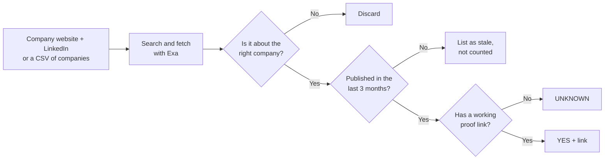

# Company Signal Scan

A Claude Code agent that tells you whether a B2B company is showing buying signals **right now**, and backs every finding with a link you can check.

Built by [Hiruni Jayasinghe](https://www.linkedin.com/in/hiruni-jayasinghe-b47600251).

## Why I built it

Outbound works best when you reach out for a reason: the company just raised, is hiring for the role you help with, or has a new leader making decisions. Finding those reasons by hand is slow, and a lot of what comes up in search is old news or about a different company with a similar name.

This agent does that research for me before a campaign. It only counts recent, verified signals, so the list I send to is based on what is happening at each company today.

## What it checks

| Signal | What it looks for |
|---|---|
| Hiring | Open roles on the careers page or ATS board (Greenhouse, Lever, Ashby, Workable) |
| Funding | New rounds, amount, stage and investors |
| Leadership change | New CEO, CMO, VP Sales, Head of Growth and similar hires |
| Expansion | New offices, markets or regions |
| Tech / tool adoption | New partnerships or tools the company says it uses |
| Press / product launch | Announcements and launches |

You can run all six, or just the ones you care about (for example, only hiring and funding).

## How it works



Three rules keep the results trustworthy:

- **Recent only.** A signal counts only if it was published in the last 3 months. A live careers page always counts, because it shows what is open today.
- **Right company.** Short or common names often match unrelated companies. Every result is checked against the company's domain, team or location before it counts.
- **Proof or it doesn't count.** Every YES comes with a link to the source. If there is no link, the result is reported as UNKNOWN, never guessed.

## Example

Single company:

```
/company-signal-scan acme.io linkedin.com/company/acme
```

Output (illustrative):

```
Company: Acme (acme.io)
Overall: 2 active signal(s) found (of 6 checked)

Hiring — YES: 3 open roles (SDR, AE, Engineer) — live today — https://acme.io/careers
Funding — NO: none found
Leadership change — NO: none found
Expansion — NO: none found
Tech/tool adoption — YES: "Built on Clay" on homepage — live today — https://acme.io
Press/launch — NO: none found

Stale mentions (>3 months, not counted toward verdict):
- ...
```

A whole list:

```
/company-signal-scan leads.csv — check hiring and funding
```

For a CSV, the agent first runs 5 companies and shows you the results to check. Once you approve, it processes the rest in batches and writes `leads-signals.csv`, keeping your original columns and adding a verdict, date and proof link for each signal.

## Setup

1. Install [Claude Code](https://claude.com/claude-code) and connect the [Exa MCP server](https://docs.exa.ai/reference/exa-mcp).
2. Copy the skill into your skills folder:

   ```
   cp -r company-signal-scan ~/.claude/skills/
   ```

3. In Claude Code, run `/company-signal-scan` with a company or a CSV.

The full instructions the agent follows are in [`company-signal-scan/SKILL.md`](company-signal-scan/SKILL.md).

## License

[MIT](LICENSE)
